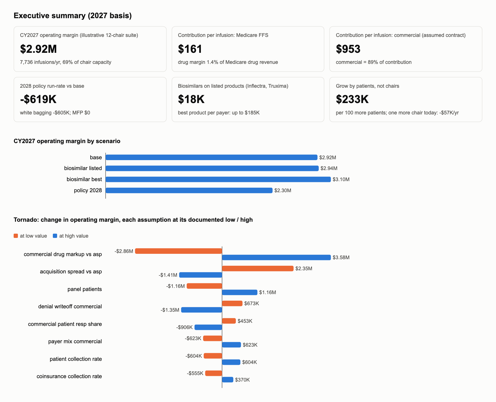
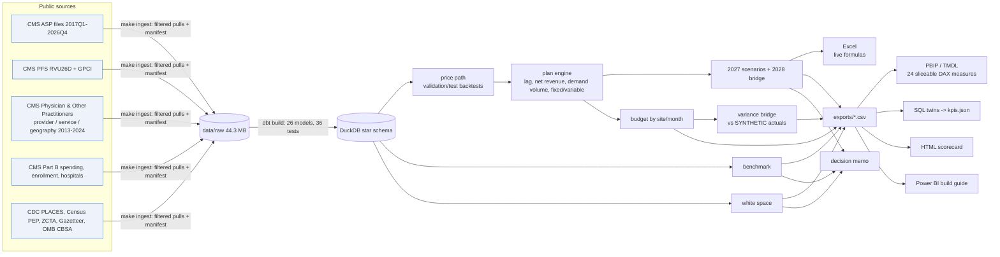

# specialty-infusion-fpa

**In-office infusion FP&A for a multi-site inflammatory-disease practice, built on public CMS data:** what
infusion really earns, how exposed it is to biosimilar, ASP and policy shifts, where growth should come from,
and how the plan becomes a monthly budget-vs-actual pack. It is written for the EVP of FP&A at a
regional inflammatory-disease practice. It uses public data only, and I have no affiliation with the operator it is modelled on.

> **Headline (2027 basis):** an illustrative 12-chair suite on a regional operator's published drug list makes
> **$2.92M** operating margin on 7,736 infusions. Medicare FFS contributes **$161** per infusion,
> because its drug margin is **1.4%** after sequestration, coinsurance bad debt and denials. The
> assumed commercial contract contributes **$953**, so commercial is 89% of contribution. The 2028
> risk is white bagging (-$605K), not Medicare negotiation ($0 on the listed drugs). Grow by patients
> (100 more add $233K), not chairs (one more costs $57K/yr at 69% utilization). Next site:
> **Northeast Ohio**: Canton-Massillon, OH (gap leader, needs recruited rheumatologists) or Cleveland (larger base).

| Problem | What I built | Key results (real numbers, reproducible) |
|---|---|---|
| Next year's plan needs to know what infusion earns and how fragile it is | Buy-and-bill engine on the real 2-quarter lag (pay on ASP t-2, buy at ASP t), biosimilar add-on on *reference* ASP, net collection for every payer, demand-driven volume, fixed vs variable cost | Medicare FFS $161, MA $55, commercial $953 per infusion. Commercial markup range moves operating margin $57K to $6.50M |
| Policy and product shifts hit at different times | Product x payer biosimilar decision table; cost-tiered white bagging with owned-pharmacy recapture; 2028 run-rate bridge; Excel with 1,757 live formulas | Listed biosimilars $18K; best product per payer up to $185K (only 4/20 picks robust); 2028 -$619K |
| Growth and the monthly pack | Market-grain white-space ranking (cross-state metros whole, prescriber floor); budget by site/month + SYNTHETIC actuals with a volume/mix/rate bridge; sliceable Power BI model | Canton-Massillon, OH: rank 2 of 74. Site A Q1 variance (SYNTHETIC) $-73,395 = volume $-49,598 + mix $-22,157 + rate $-1,639 |



---

## Executive decision memo: CY2027 in-office infusion plan

**To:** EVP, Financial Planning & Analysis. **From:** Zhengtao (Tony) Li. **Date:** 2026-11-02.
**Basis:** public CMS / CDC / Census data, one price basis (2027: Medicare pays on the ASP of two quarters
earlier, the practice buys at the current ASP). Patients, payer mix, contracts and costs are labelled
assumptions for an illustrative 12-chair suite with a regional operator's published drug list. Read the $ per
infusion and the deltas; the totals are illustrations.

### Recommendation
1. **Budget the infusion line as a commercial-contract business.** The 2027 base case gives 7,736
   infusions for 1,700 patients (69% of chair capacity). Contribution is $3.95M; after $1.03M of
   fixed suite cost, operating margin is $2.92M. Medicare FFS contributes $161 per infusion: ASP+6% nets
   to 4.3% after sequestration, and after coinsurance bad debt and denials the Medicare drug margin is
   1.4% of drug revenue. MA contributes $55. The assumed commercial contract contributes $953,
   after patient bad debt, denials and underpayment (93.2% collected). Commercial is 48% of
   infusions and 89% of contribution.
2. **Decide biosimilars product by payer; don't push them across the board.** Moving infliximab and rituximab
   to 80% on the listed products (Inflectra, Truxima) changes operating margin by $18K.
   Giving each payer its best-margin product would add up to $185K. But only 4 of 20 of
   those payer-level picks survive the products' own price swings over the last 12 quarters. The workable
   rule: put Medicare patients on the IRA +8% products while that window lasts, and ask commercial payers to
   price biosimilars on reference-ASP terms before converting them.
3. **Contract for 2028 now; the exposure is white bagging, not drug negotiation.** The 2028 run-rate changes
   operating margin by -$619K. White bagging accounts for -$605K (tiered by drug cost, net of the owned specialty pharmacy
   recapture), and the end of the +8% add-on for -$14K. Medicare negotiation costs $0 on the listed drug
   list, because none of those drugs was selected. Adding Orencia to the formulary (selected drugs would be
   20% of infusions in a full-formulary book) changes this by only -$35, because the Medicare margin on it is
   about 1%. Priorities: site-of-care and white-bagging carve-outs in contracts; the owned specialty pharmacy in payer
   networks (each 25 points of recapture is worth $56K).
4. **Grow by patients, not chairs.** At 69% utilization, another chair adds $57K of fixed cost and
   no volume (-$57K a year). 100 more patients add $233K. Once demand exceeds capacity, an added
   chair breaks even at 12% utilization. For a new site, Northeast Ohio leads.
   - **Canton-Massillon, OH** ranks 2 of 74 and is in the top 10 under 76% of random weightings. It has
     4.7 relevant specialists per 100k and 0 Medicare-billing rheumatologists, so a site
     there means recruiting.
   - **Cleveland** (rank 6, 58%, 37 rheumatologists) is the larger base.
   - Detroit-Warren-Dearborn, MI ranks first (63%) but leaves Ohio.

### Risks
- **Commercial terms dominate.** Across the documented markup range (8% to 35% over ASP),
  operating margin runs from $57K to $6.50M. Purchasing is next: an acquisition spread of -5% to
  +3% vs ASP moves it from $5.27M to $1.51M.
- **Price path.** Across the test window, no forecasting model beat naive (MAPE 6.6% naive vs
  6.4% for the selected models), so 2027 prices are held at the latest file. That makes the lag spread
  zero in the base. In 30% of past drug-quarters (36% dollar-weighted), Medicare's collected payment fell
  below the price the practice paid at the time. The held-flat path's 80% band covered 83% of test
  outcomes.
- **Orencia pricing.** Orencia's Medicare limit is set on WAC ("lesser of"). If acquisition tracked its old
  ASP trend, a full rheum formulary would lose $3.96M a year.
- **Data limits.** Medicare FFS only; MA claims are not public. The drug mix comes from what
  neurologists and rheumatologists bill in office nationally, and it under-represents hospital-based MS
  infusion. Provider-level biosimilar rates cannot be measured through CMS suppression, so adoption is
  benchmarked by state (infliximab 11.0% Ohio vs 14.1% US).

### What would change this recommendation
- Commercial biosimilar contracts priced on reference-ASP terms: biosimilar conversion becomes a margin lever.
- Acquisition cost above ASP (non-GPO purchasing): Medicare and MA infusions turn loss-making.
- the owned specialty pharmacy inside the big payers' specialty networks, or white bagging below the assumed tiers: the 2028
  exposure shrinks.
- Referral data showing Northeast Ohio demand already served. Weight-stability of the ranking is moderate
  (mean top-10 overlap 51%), so referral data should outweigh it.

**The three internal numbers that would sharpen this most:** commercial drug terms by payer, invoice
acquisition cost vs ASP for the top 10 drugs, and the active patient panel by drug and payer.

*Every figure above is filled from `outputs/*.json` by `make memo`; `tests/test_memo.py` fails if a number
in the memo cannot be traced to the model.*

---

## Architecture



## Data sources (all public; filtered pulls; see `data_manifest.json` and ADR 0002)

| Source | Used for | Link | License / terms |
|---|---|---|---|
| CMS ASP payment-limit files (40 quarters) | price path, lag, IRA flags, "lesser of" | [cms.gov ASP files](https://www.cms.gov/medicare/payment/part-b-drugs/asp-pricing-files) | US Government work. Only HCPCS Level II kept (pre-2021 files sit behind the CMS/AMA CPT page) |
| CMS PFS RVU26D, GPCI | admin fees (CY2026 RVUs, CY2027 proposed CF) | [PFS files](https://www.cms.gov/medicare/payment/fee-schedules/physician/pfs-relative-value-files) | Public; no CPT descriptors stored |
| Medicare Physician & Other Practitioners | dose, admins/patient, drug mix by specialty, benchmarks, supply | [data.cms.gov](https://data.cms.gov/provider-summary-by-type-of-service/medicare-physician-other-practitioners) | Public; rows < 11 beneficiaries suppressed |
| Medicare Part B Spending by Drug | 2025 out-of-sample check; realization reconciliation | [data.cms.gov](https://data.cms.gov/summary-statistics-on-use-and-payments/medicare-medicaid-spending-by-drug/medicare-part-b-spending-by-drug) | Public |
| Medicare Monthly Enrollment; Hospital General Information | Ohio FFS vs MA split; hospital-heavy market flag | [enrollment](https://data.cms.gov/summary-statistics-on-beneficiary-enrollment/medicare-and-medicaid-reports/medicare-monthly-enrollment), [hospitals](https://data.cms.gov/provider-data/dataset/xubh-q36u) | Public |
| CMS IPAY 2028 list; IRA s.11403 biosimilar FAQ | MFP exposure; +8% window | [fact sheet](https://www.cms.gov/files/document/factsheet-medicare-negotiation-selected-drug-list-ipay-2028.pdf), [FAQ](https://www.cms.gov/files/document/biosimilar-faqs.pdf) | Public |
| CDC PLACES; Census PEP, ZCTA, Gazetteer; OMB CBSA | demand, population, geography, metros | [PLACES](https://data.cdc.gov/resource/i46a-9kgh.json), [census.gov](https://www.census.gov/programs-surveys/popest.html) | Public domain (ACS API needs a key, so PEP is used) |
| A regional operator's public website | footprint, published drug list (the plan formulary) | not linked in the public version | Public pages only (ADR 0001) |

## How to run

```bash
make init          # uv env with pinned deps + Chromium for screenshots
make check         # lint + dbt on fixtures + pytest (88 test functions, incl. regeneration on fixtures) + strict feature gate
make reproduce     # full rebuild from public pulls
make monthly-pack  # month-end pack: refresh, DQ, budget vs actual bridge, memo, scorecard (OFFLINE=1 skips the pull)
```
data.cms.gov rate-limits repeated full pulls (HTTP 429); `make ingest` backs off and writes the manifest after
each source. Open `excel/infusion_plan_2027_scenarios.xlsx` (blue cells are inputs), `docs/scorecard.html`,
and follow `docs/powerbi_build_guide.md` to build the report pages in Power BI Desktop.

## Results (every value is produced by the command / file shown)

| Area | Metric | Value | Source |
|---|---|---|---|
| Data | raw sources / size | 15 / 44.3 MB | `data_manifest.json` |
| Data model | dbt models / tests / business-rule tests (all pass) | 26 / 36 / 10 | `outputs/dbt_summary.json` |
| Mechanics | ASP+6% after sequestration (full coinsurance collection); Ohio 96413 at CY2027 proposed CF | ASP + 4.3%; $120.65 | `outputs/margin.json` |
| Pricing | Medicare paid below current price: raw / after sequestration / after sequestration + coinsurance (drug-quarters; $-weighted) | 6.2% / 12.0% / 30% (36%) | `outputs/margin.json` |
| Plan 2027 | contribution / operating margin / infusions / utilization | $3,953,477 / $2,920,062 / 7,736 / 69% | `outputs/scenarios.json` |
| Plan 2027 | contribution per infusion: Medicare FFS / MA / commercial | $161 / $55 / $953 | `outputs/scenarios.json` |
| Growth | added chair at current demand / 100 more patients / added-chair break-even utilization | -$57K / $233K / 12% | `outputs/scenarios.json` |
| Forecast | quarterly ASP, test window MAPE: naive / validation-selected (33 modelled, 30 held flat) | 6.6% / 6.4%; DM p 0.004-0.022 (selected worse) | `outputs/forecast.json` |
| Forecast | annual volume MAPE naive / selected; spend MAPE naive / selected | 16.4% / 18.3%; 20.2% / 28.7% | `outputs/forecast.json` |
| Forecast | 80% interval coverage on the test window: ASP / volume / spend | 83% / 79% / 65% | `outputs/forecast.json` |
| Excel | live formulas / max rel. diff vs Python (default + stressed inputs, LibreOffice recalc) | 1,757 / 5.0e-07 | `outputs/excel_recalc_check.json` |
| Benchmark | clinicians scored / provider-molecule pairs fully observed / above vs below state | 7,649 / 0% of 284 / 2 vs 0 | `outputs/benchmark.json` |
| Market | eligible markets / Canton-Massillon, OH rank, share of weightings in top 10 / mean top-10 overlap | 74 / 2, 76% / 51% | `outputs/market.json` |
| Power BI | TMDL tables / DAX measures (each mapped to a SQL twin; several checked independently in pandas) | 23 / 24 | `tests/test_tmdl.py` |
| Variance (**SYNTHETIC** actuals) | Site A Jan-Mar: total = volume + mix + rate | $-73,395 = $-49,598 + $-22,157 + $-1,639 | `outputs/variance_pack_SYNTHETIC.json` |
| RCM (**SYNTHETIC**) | clean-claim / denial / days in AR / net collection | 81.9% / 11.2% / 57.0 / 91.0% | `outputs/rcm_kpis_SYNTHETIC.json` |
| Automation | DQ pass / flag / fail; manual steps replaced (est. hours) / measured run | 6 / 3 / 0; 19 (12.2 h est.) / 0.6 min | `outputs/monthly_pack_last.json` |

## How this maps to the job

| FP&A work in the JD | Where it lives here |
|---|---|
| Power BI dashboards and scorecards | `powerbi/`: star schema, date table, site / payer / drug / month slicing, budget vs actual measures; `docs/powerbi_build_guide.md` |
| Clean, join, validate multi-source data | `dbt/`: one star schema from the public sources; HCPCS continuity, biosimilar qualification, exact reconciliation to CMS's published averages, suppression-aware sums |
| Financial / payer analysis | per-infusion economics by drug x payer with net collection; product x payer biosimilar decisions; tornado |
| Forecasting, budgeting, variance | backtested price/volume forecasts; 2027 plan by site and month; volume/mix/rate bridge; Excel model |
| Benchmarking, market analysis, growth | state-level biosimilar adoption, suppression-aware provider intervals; metro white-space ranking; chair vs patient growth economics |
| Revenue cycle | KPI logic on **SYNTHETIC** 837/835 data, and net-collection factors per payer as plan drivers |
| Automate recurring workflows | `make monthly-pack`: refresh, DQ, variance bridge, memo, scorecard (19 manual steps) |
| Executive communication | `docs/MEMO.md`: recommendation, risks, what would change it |

## Known limitations / what differs from production
- **Practice inputs are assumptions** (`config/assumptions.yaml`): patient panel, payer mix, service-line
  split, contract terms, collection rates and costs. Absolute dollars are illustrative; the tornado shows
  each one's weight.
- **Drug mix**: national in-office Medicare billing by neurologists and rheumatologists, restricted to
  the operator's published drugs, with Ohio biosimilar shares on the listed products. Hospital-administered
  MS infusion is not in physician data.
- **Prices are held flat for 2027** because no model beat naive on the test window. The lag mechanics are
  built in, but they produce no spread on a flat path. Acquisition is proxied by ASP; for WAC-priced
  ("lesser of") codes the proxy is a lower bound, and a range is shown.
- **Allowed vs payment limit**: physician-PUF allowed per unit is 96.4% of the payment limit, and Part B
  Spending per unit is 97.8%, including for flat-price codes. That makes it a systematic or
  definitional effect, not a practice risk, so it is excluded from the plan (`make dq` keeps it under watch).
- **2027 PFS** uses CY2026 RVUs with the proposed CY2027 CF. **2028** applies 2028 rules to 2027 prices.
  **MFPs** (due 2026-11-30) are an assumed discount.
- **Benchmarking**: CMS suppression leaves no provider-molecule pair fully observed, so provider labels are
  interval-based and mostly "insufficient data". State-level adoption is the reliable comparison.
- **Market**: arthritis prevalence is all-type. Hospital outpatient infusion volume is not public at market
  level, so hospital-heavy markets are flagged by hospital density instead of being scored.
- **Power BI: the PBIP has not been opened in Power BI Desktop** (built on macOS). Each measure is mapped to
  a SQL twin in a stated filter context; the budget, variance and adoption twins are re-derived
  independently in pandas. The DAX itself has never been executed. Report pages are built by hand from the
  guide.
- **SYNTHETIC data** (RCM, monthly actuals) supports no conclusion.

ADRs for the decisions an interviewer will probe are in `docs/decisions/`. Acceptance evidence is in
`docs/ACCEPTANCE.md`.
