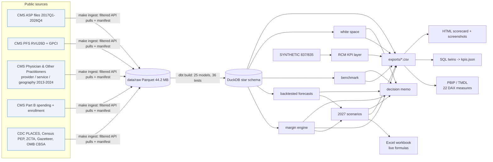

# specialty-infusion-fpa

**In-office infusion FP&A for a multi-site inflammatory-disease practice, built on public CMS data:** how much
margin infusion really makes, how exposed it is to biosimilar, ASP and Medicare-negotiation shifts, and where
the next site should go. It is written for the EVP of FP&A at a regional inflammatory-disease practice. It uses public data
only, and I have no affiliation with the operator it is modelled on.

> **Headline:** a chair infusion earns about **$376** in 2027 (base case). Medicare FFS contributes
> **$101** per infusion. Its drug margin is **2.1%** after sequestration and
> coinsurance bad debt. The assumed commercial contract contributes **$646**, so commercial is
> 86% of infusion contribution. A blanket biosimilar push *lowers* contribution
> (-$180K). The 2028 policy stack (MFP + white bagging) changes contribution by **-$643K** a year. The next site:
> **Cleveland, OH** (strongest Ohio market outside Columbus, P(top 10) = 77%).

| Problem | What I built | Key results (real numbers, reproducible) |
|---|---|---|
| Next year's plan needs to know how much margin infusion makes and how fragile it is | Buy-and-bill engine: ASP+6% with the 2-quarter lag, biosimilar add-on on *reference* ASP, sequestration, Ohio PFS admin fees, observed dose per infusion. Tornado over every assumption | Medicare drug margin 2.1% of drug revenue. Break-even acquisition price ASP+3.7%. Measured 2024 allowed/PL realization 96.8% |
| Policy shifts (biosimilars, IRA +8% expiry, MFP 2028, PFS cut) hit at different times | Backtested forecasts (ASP MAPE 3.0% vs naive 3.5%). 3 scenarios in Python **and** an Excel workbook with 1,635 live formulas | Base $5.2M, biosimilar push -$180K, policy shock -$643K (illustrative 12-chair suite) |
| Growth: where to add sites, chairs or providers | Market-grain white-space ranking (7 states, 83 eligible markets) with a 2,000-draw weight-stability test; provider benchmarks with EB shrinkage | Cleveland, OH: rank 5, P(top 10) 77%. One chair = $435K/yr. Each 5 pts of utilization = $373K |


---

## Executive decision memo: CY2027 in-office infusion plan

**To:** EVP, Financial Planning & Analysis. **From:** Zhengtao (Tony) Li. **Date:** 2026-11-02.
**Basis:** public CMS / CDC / Census data (ASP files through 2026Q4). Practice volumes, payer mix and
contract rates are labelled assumptions for an illustrative 12-chair suite in Ohio. Use the $ per
infusion and the % figures; the totals are illustrations.

### Recommendation
1. **Budget the infusion line as a commercial-contract business, not a drug-volume business.** Base-case 2027
   contribution is $376 per chair infusion (-1.4% vs 2026Q4 prices), or
   $5.2M on 13,866 infusions at 70% chair utilization. Medicare FFS earns $101 per
   infusion. Its drug margin is only 2.1% of drug revenue: ASP+6% nets to 4.3% after
   sequestration, before coinsurance bad debt. Commercial earns $646 (assumed contract). Commercial is
   50% of volume but 86% of infusion contribution.
2. **Do not run a blanket biosimilar conversion for margin.** Moving infliximab, rituximab, tocilizumab and
   natalizumab to 80% biosimilar changes contribution by -$180K (-3.4%). Medicare gains
   $16 per infusion, because the IRA add-on is 8% of the *reference* ASP. Commercial loses
   $38 per infusion, because ASP-plus contracts pay less on a cheaper drug. Convert where payers
   mandate it, or where a contract pays at least $94 more per switched commercial infusion
   (shared savings or reference-ASP pricing).
3. **Contract for the 2028 policy stack now.** 39% of the chair-infusion mix is Orencia or Entyvio,
   both selected for Medicare negotiation (MFP effective 2028). At an assumed 35% MFP discount the
   Medicare effect is only -$61K, because Medicare margin is already thin. The larger exposure is payer
   white bagging: -$582K if 15% of commercial infusions move to specialty pharmacy. Together that is
   -$643K per year. The scheduled end of the +8% biosimilar add-on (2027-09-30) is small for this mix
   (-$413 full-year).
4. **Grow capacity in Ohio first, and pick the next site at metro grain.** National in-office Medicare
   administrations of these drugs grew 5.4% a year from 2019 to 2024 (2.30M in 2024). One chair
   is worth $435K a year, and each 5 points of utilization is worth $373K. Fill chairs before
   adding them. For a new comprehensive site, **Cleveland, OH** is the strongest Ohio market outside the Columbus
   catchment: rank 5 of 83, 131 miles away, 12.5 relevant specialists per 100k, in
   the top 10 under 77% of 2,000 random weightings. Detroit-Warren-Dearborn, MI (84%) and Chicago-Naperville-Elgin, IL-IN (75%) rank higher but
   leave Ohio. Chicago pairs with the existing Wood Dale (the owned specialty pharmacy) footprint.

### Risks
- **Realization.** In 2024 the national in-office allowed amount per billed unit was 96.8% of the
  average quarterly payment limit. If that 3.2% gap is real for us, it is larger than the Medicare
  drug margin. Check it against our 835s before relying on any Medicare drug margin.
- **Commercial terms dominate.** Across the documented range (8% to 35% over ASP), annual
  contribution runs from $2.9M to $8.2M. No other driver moves the answer as much.
- **Purchasing.** A Medicare infusion stops covering its chair cost if we buy 3.7% above ASP.
- **Forecasts.** Quarterly ASP backtest MAPE is 3.0% (damped ETS) vs 3.5% naive and
  5.1% seasonal naive. Annual volume MAPE is 14.2% vs 15.9% naive. On the
  2025 out-of-sample check, spend MAPE was 13.1% vs 17.1% naive. Volume is the uncertain
  part, not price.
- **Data limits.** Medicare FFS only (MA claims are not public). Provider-level biosimilar rates are censored
  for 99.5% of provider-molecule pairs, so adoption is benchmarked at state level (infliximab biosimilar
  share 11.0% in Ohio vs 14.1% nationally).

### What would change this recommendation
- Commercial contracts that pay biosimilars on reference-ASP terms, or share at least $94 per
  switched infusion. Biosimilar conversion would then add margin.
- Acquisition cost at or above ASP+3.7% (non-GPO purchasing). Medicare infusion volume would then
  need to be capped or re-routed.
- Published MFPs (due 2026-11-30) far below the assumed 35% discount, or payer white bagging above
  15%. The 2028 exposure would then become the first-order issue.
- Internal referral and leakage data that contradicts the public ranking. The ranking is only moderately
  stable (mean top-10 overlap under random weightings: 65%), so referral data should outweigh it.

**Three internal numbers that would most sharpen this:** commercial drug terms by payer (markup over ASP or
% of WAC), invoice acquisition cost vs ASP for the top 10 drugs, and chair utilization plus payer mix by site.
In this region's Medicare data, drugs are 84% of allowed for infusing rheumatologists, so these
three inputs decide most of the practice's revenue picture.

*Every figure above is filled from `outputs/*.json` by `make memo` (`src/sifpa/memo.py`); `tests/test_memo.py`
fails if a number in the memo cannot be traced to the model.*

---

## Architecture



## Data sources (all public; filtered pulls; see `data_manifest.json` and ADR 0002)

| Source | Used for | Link | License / terms |
|---|---|---|---|
| CMS ASP payment-limit files (40 quarters) + NDC-HCPCS crosswalk | prices, implied ASP, lag spread, IRA flags | [cms.gov ASP pricing files](https://www.cms.gov/medicare/payment/part-b-drugs/asp-pricing-files) | US Government work. Pre-2021 files sit behind the CMS/AMA CPT license page; only HCPCS Level II codes are kept |
| CMS PFS RVU26D, GPCI, localities | admin fees (96413/96415/96365/96366/96372) | [PFS relative value files](https://www.cms.gov/medicare/payment/fee-schedules/physician/pfs-relative-value-files) | Public. CPT codes are AMA copyright: no descriptors stored |
| Medicare Physician & Other Practitioners (by provider and service / provider / geography and service) | dose, volume, mix, benchmarks, supply | [data.cms.gov](https://data.cms.gov/provider-summary-by-type-of-service/medicare-physician-other-practitioners) | Public. Rows < 11 beneficiaries suppressed by CMS |
| Medicare Part B Spending by Drug (annual + quarterly) | 2025 out-of-sample check | [data.cms.gov Part B spending](https://data.cms.gov/summary-statistics-on-use-and-payments/medicare-medicaid-spending-by-drug/medicare-part-b-spending-by-drug) | Public |
| Medicare Monthly Enrollment (county) | Original Medicare vs MA share | [data.cms.gov enrollment](https://data.cms.gov/summary-statistics-on-beneficiary-enrollment/medicare-and-medicaid-reports/medicare-monthly-enrollment) | Public |
| CMS IPAY 2028 selected drugs; CMS biosimilar (IRA s.11403) FAQ | MFP exposure, +8% window | [fact sheet](https://www.cms.gov/files/document/factsheet-medicare-negotiation-selected-drug-list-ipay-2028.pdf), [FAQ](https://www.cms.gov/files/document/biosimilar-faqs.pdf) | Public |
| CDC PLACES county 2025 (2024 for KY/PA) | arthritis prevalence | [data.cdc.gov](https://data.cdc.gov/resource/i46a-9kgh.json) | Public domain |
| Census PEP vintage 2025, ZCTA-county 2020, Gazetteer 2025, OMB CBSA 2023 | population, 65+, geography | [census.gov](https://www.census.gov/programs-surveys/popest.html) | Public domain. The ACS API now needs a key, so PEP is used instead |
| operator website (public pages) | footprint, drug list, geography choice | not linked in the public version | Public information only (ADR 0001) |

## How to run

```bash
make init          # uv env with pinned deps + Chromium for screenshots
make check         # offline gate: ruff + pytest (81 test functions) + dbt on fixtures + feature regression
make reproduce     # full rebuild from public pulls (~5 min, ~44.2 MB raw)
make monthly-pack  # the recurring refresh, timed step by step
```
Reproducibility note: data.cms.gov rate-limits repeated full pulls (HTTP 429). `make ingest` backs off and
writes the manifest after every source. A same-day re-pull reproduced 12 of the 14 raw files byte for byte
(sha256 match with `data_manifest.json`) before the API throttled it. The offline rebuild
(`make monthly-pack OFFLINE=1`: dbt -> analyses -> exports -> Excel -> memo -> scorecard -> tests) runs end to end.

Open `excel/infusion_plan_2027_scenarios.xlsx` (change any blue input) and `docs/scorecard.html`. On Windows,
open `powerbi/SpecialtyInfusionFPA.pbip` after setting the `RepoPath` parameter.

## Results (every value is produced by the command / file shown)

| Area | Metric | Value | Source |
|---|---|---|---|
| Data | raw sources / size / ASP quarters | 14 / 44.2 MB / 40 | `data_manifest.json` |
| Data model | dbt models / tests / business-rule tests (all pass) | 25 / 36 / 10 | `outputs/dbt_summary.json` |
| Mechanics | ASP+6% after sequestration (full coinsurance collection) | ASP + 4.3% | `outputs/margin.json` |
| Mechanics | Ohio CY2026 non-facility 96413 / chair cost per hour | $122.71 / $40.58 | `outputs/margin.json` |
| Pricing | median lag spread (ref/single-source, last 8 qtrs) / underwater drug-quarters | 5.3% / 5.5% | `outputs/lag_spread_by_drug.csv` |
| Margin | contribution per infusion: Medicare FFS / commercial (2027 base) | $101 / $646 | `outputs/scenarios.json` |
| Margin | allowed / payment limit, 2024 in-office (measured) | 96.8% | `outputs/margin.json` |
| Forecast | quarterly ASP MAPE: damped ETS / naive / seasonal naive (18 drugs, h=1-4) | 3.0% / 3.5% / 5.1% | `outputs/forecast.json` |
| Forecast | annual volume+spend MAPE: damped ETS / naive (22 series, h=1-2) | 14.2% / 15.9% | `outputs/forecast.json` |
| Forecast | 80% PI coverage on held-out origins (all models) | 67% to 85% | `outputs/forecast.json` |
| Forecast | 2025 out-of-sample spend MAPE: damped ETS / naive (19 molecules) | 13.1% / 17.1% | `outputs/forecast_external_2025.csv` |
| Scenarios | 2027 contribution: base / biosimilar push / policy shock | $5,216,116 / $5.04M / $4.57M | `outputs/scenarios.json` |
| Excel | live formulas / max rel. diff vs Python after LibreOffice recalc | 1,635 / 1.6e-05 | `outputs/excel_recalc_check.json` |
| Benchmark | clinicians scored / biosimilar rates censored / above vs below peer | 7,649 / 99.5% / 4 vs 35 | `outputs/benchmark.json` |
| Benchmark | infliximab biosimilar share 2024: Ohio / US | 11.0% / 14.1% | `outputs/benchmark.json` |
| Market | eligible markets / Cleveland, OH rank, P(top 10) / mean top-10 overlap | 83 / 5, 77% / 65% | `outputs/market.json` |
| Power BI | TMDL tables / DAX measures, each with a SQL twin equal to `kpis.json` | 18 / 22 | `tests/test_tmdl.py` |
| RCM (**SYNTHETIC**) | clean-claim / denial / days in AR / net collection | 81.9% / 11.2% / 57.0 / 91.0% | `outputs/rcm_kpis_SYNTHETIC.json` |
| Automation | DQ checks pass / flag / fail; manual steps replaced (estimated hours) / measured run | 5 / 3 / 0; 17 (10.5 h est.) / 0.4 min | `outputs/dq_report.json`, `outputs/monthly_pack_last.json` |

## How this maps to the job

| FP&A work in the JD | Where it lives here |
|---|---|
| Power BI dashboards and scorecards | `powerbi/` PBIP + TMDL (star schema, date table, 22 documented DAX measures); `docs/scorecard.html` mirrors the pages |
| Clean, join, validate multi-source data | `dbt/`: 14 public sources into one star schema; tests for HCPCS continuity, biosimilar qualification, payment <= allowed, suppression-aware reconciliation, no fan-out |
| Financial / operational / payer analysis | per-infusion economics by drug and payer, lag spread, biosimilar conversion, tornado (`src/sifpa/margin.py`) |
| Forecasting, scenarios, plan support | backtested forecasts + 2027 scenarios; Excel workbook FP&A can edit (`excel/`) |
| Benchmarking, market analysis, growth | provider scorecards with EB shrinkage; white-space ranking at metro grain |
| Revenue cycle | KPI logic (clean-claim, CARC denials, days in AR, NCR) in SQL + DAX on **SYNTHETIC** 837/835 data, ready to point at real remits |
| Automate recurring workflows | `make monthly-pack` (timed, 17 manual steps replaced), DQ flags, CI |
| Executive communication | `docs/MEMO.md`: recommendation, risks, and what would change it |

## Known limitations / what differs from production
- **Medicare FFS only.** MA and commercial claims are not public. Commercial reimbursement, payer mix, chair
  count, utilization and costs are **labelled assumptions** (`config/assumptions.yaml`), so absolute dollars are
  illustrative. The tornado shows how much each one matters.
- **Acquisition cost is proxied by ASP.** GPO/contract prices, rebates, discarded-drug (JW/JZ) amounts and bad
  debt beyond coinsurance are not modelled. The measured **96.8% allowed/PL realization** is
  unexplained (unit-billing artifacts, MSP or deductible effects are candidates) and appears only as a downside.
- **2027 PFS** uses the July 2026 *proposed* conversion factor. **IPAY 2028 MFPs** were not published at build
  time, so the discount is an assumption.
- **CMS cell suppression (< 11)** censors provider-level biosimilar rates (99.5% of provider-molecule
  pairs). Adoption is therefore benchmarked at geography level, and provider ranks carry intervals.
- **Market analysis**: arthritis prevalence (all types) is a weak proxy for inflammatory disease. There is no
  public county MS prevalence. ZIP does not equal ZCTA. Supply counts are Medicare FFS billers only, and an infusion biller only
  counts where CMS shows a row (11 or more beneficiaries for a code), so supply is undercounted in small markets. Some CBSAs cross
  the region (flagged).
- **Forecasts**: the annual series are short (2013-2024), and per-series model choice is optimistic (ADR 0004).
- **Power BI: the PBIP has not been opened in Power BI Desktop** (built on macOS). The TMDL is validated
  structurally, and every measure's logic is mirrored by a SQL twin that reproduces the published value.
  Report pages are shells; the visual layout lives in the HTML scorecard.
- **RCM data is SYNTHETIC** and supports no conclusion.

Decisions an interviewer will probe are in `docs/decisions/` (8 ADRs). Acceptance evidence is in
`docs/ACCEPTANCE.md`.
